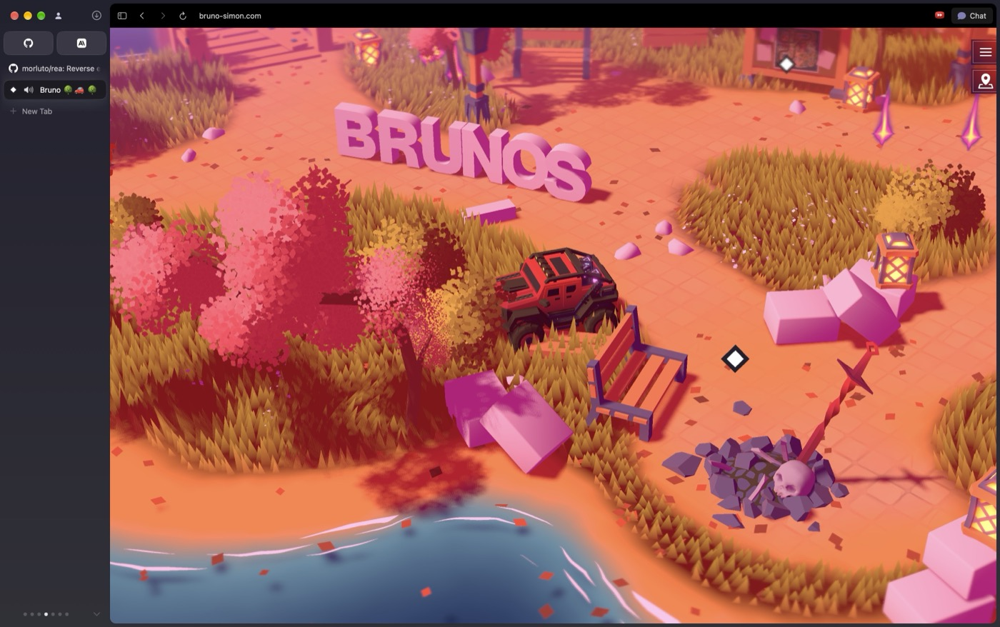
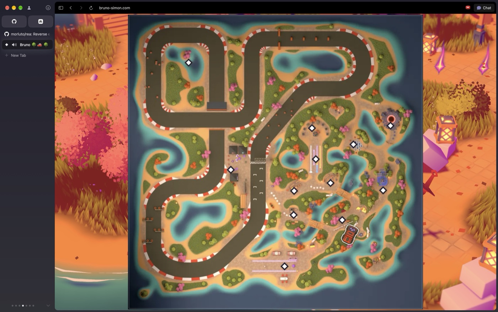
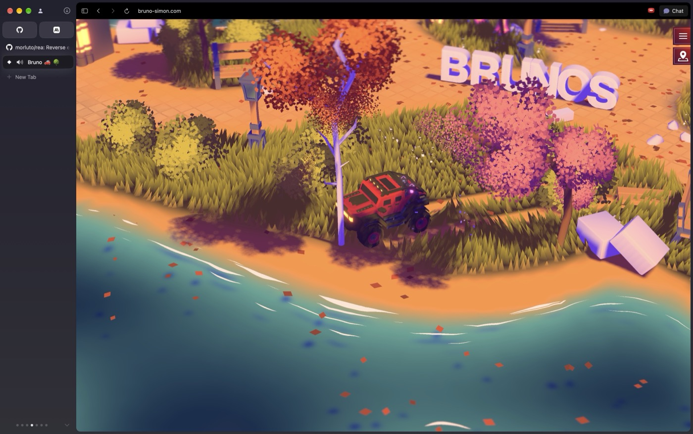
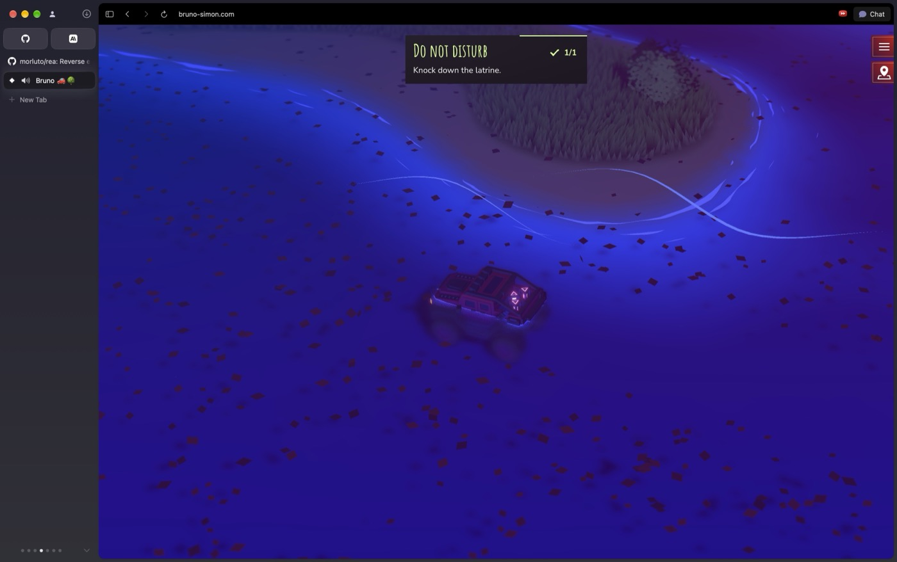
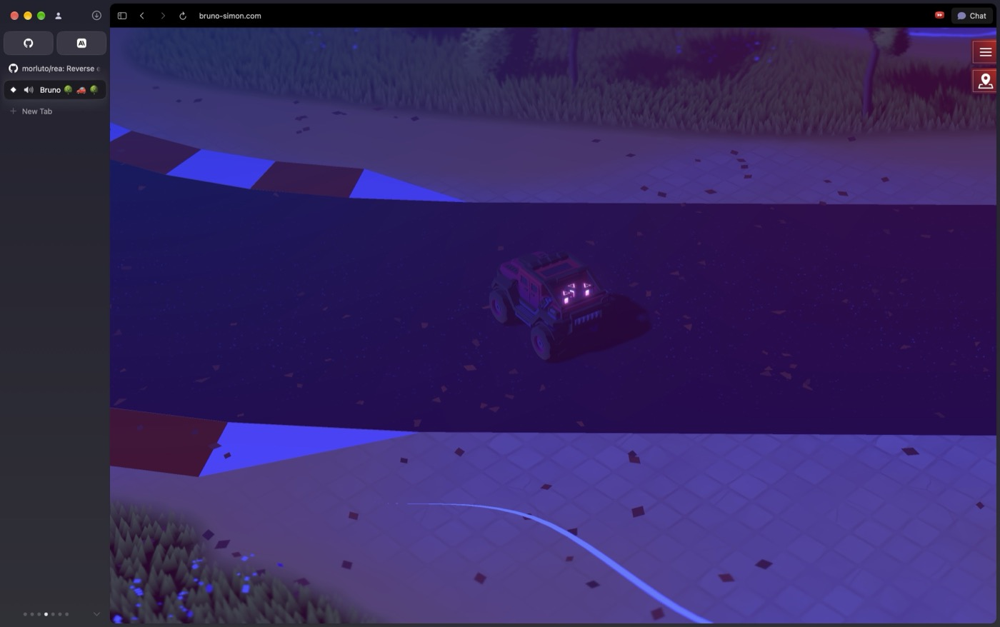
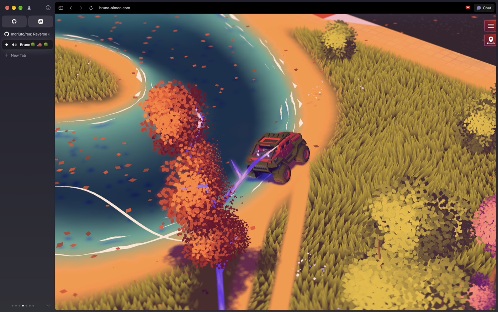

# Bruno Simon live-site investigation

October 31, 2026. Research for Sri’s portfolio. This report records browser observations separately from static-source findings and proposed implementation.

## Live browser exploration

The in-app Browser rendered the scene but its keyboard calls returned `browser.user is unavailable`. The Computer tool opened the public site in a new Dia tab. Enter started the scene; Up/Down and alternating Left/Right steering were used to drive. M opened/closed the map; R respawned; B was used to brake. Native multi-arrow chords were unsupported, so exploration used acceleration followed by steering while coasting. This limited route precision.

### Arrival and close asset composition

The car, benches, lanterns, vegetation and ground have clear silhouettes and a common color/shading treatment. Small foreground detail and larger background masses belong to the same setting. This is a visual observation, not an assertion about polygon count.

### Whole-world map

The map exposes the full circuit, water network, routes, destination markers and player position. This was opened in the browser. The source additionally shows day/night image selection and click-to-respawn destination behavior. Destination-marker teleportation was not successfully exercised in this session.

### Driving into vegetation

The car reached planted ground; wheel/vehicle presentation, terrain contact, canopy shading and camera tracking remained visually coherent. Grass and shore detail continue around the route rather than appearing as isolated decorative props. The source explains the wind shader and foliage visibility mask; this screenshot alone cannot prove their time-dependent behavior.

### Collision and water

The actual session triggered the “Do not disturb / Knock down the latrine” achievement during driving and then reached water. The frame records the achievement and submerged vehicle state. It does not establish a complete physical model of water. Respawn was subsequently used successfully.

### Circuit at night

The vehicle reached the circuit. The night state changes the whole scene palette, including water, ground and foliage. It does not simply switch off the primary light. Subject clarity still varies with the view; this is not a claim that every reference view is perfect.

### Coast in daylight

The bank is a layered transition: dry ground, wet/shallow band, deeper water and broken moving-looking shoreline strokes. Planting follows land masses and leaves occupy the water/ground context. The image records appearance; movement mechanisms are established by the source review below.

## REA and source findings

REA 4.0.1 analyzed the checked-out source without executing it. It parsed 126 JavaScript files, with zero parse failures and zero truncated scopes. The analysis and weather feature trace identifiers, source SHA, graph counts and limitations are in [rea-report.json](rea-report.json). The latest repository docs describe a summary command absent from published 4.0.1; a compact JSON report was extracted from the actual saved evidence. REA did not attach to the browser, capture audio, or authenticate the live bundle against this source commit.

Confirmed source mechanisms:

- **Asset production:** the repository contains `resources/folio-2025.blend`, `resources/models/bruno-sudo.blend`, a palette texture and exported GLBs. The README describes Blender export. `scripts/compress.js` applies ETC1S texture compression and Draco mesh compression; palette/terrain textures receive separate UASTC presets. This supports a Blender-authored scene pipeline, not a claim about the origin of every individual third-party asset.
- **Common shading:** a palette-driven custom Lambert material combines colored core/cast shadows, terrain-colored ground bounce, fog and reveal behavior. Its consistency is central to the visual result.
- **Camera:** 25° perspective FOV, controlled elevated angle, radius 15–30, smooth tracking and additional distance at narrow aspect ratios. This is a compositional constraint, not a universal lens recommendation for Sri’s interiors.
- **Foliage:** merged textured planes, adjusted normals and instancing. Selected foliage uses a zoom-scaled screen-space mask around the car to improve visibility. This is not proof that every building or prop fades.
- **Grass:** height and placement read terrain data; shader displacement reads shared wind and weights movement toward blade tips. Track texture affects terrain/grass response. No per-blade rigid-body simulation is needed for that effect.
- **Climate:** a four-minute day cycle and seasonal keyframes contribute to synthetic weather. Humidity/clouds drive precipitation; temperature drives freezing/melting behavior. Wind is shared with environmental visuals. Runtime snow/ice/storm cases were not exercised.
- **Water:** terrain/depth color, shore/ripple shader effects, temperature-dependent ice and physics interaction hooks. Broad ocean realism is not obtained from a water texture alone.
- **Object behavior:** Blender node naming and custom metadata distinguish visible meshes and physical proxies, including cuboids, balls, cylinders, hulls and triangle meshes. Bodies can sleep, and instanced visuals update when physical objects move.
- **Sound:** material impact groups, impact-force volume mapping, positional playback, distance fade, sound variations and day/weather-driven ambience. Bricks and lanterns have explicit audio callbacks. Some bench/fence callbacks are commented out; do not claim universal per-object audio from this source. Sound quality across all assets remains unaudited by listening.

## Implications for Sri

The project needs a coherent world composition and asset-behavior pipeline. Better materials are one part of it. The proposal combines authored land/coast shapes, camera-safe local views, refined asset families, shared weather motion, meaningful physics and material-specific sound. The entire plan, milestones, file map and acceptance gates are in [WORLD-CRAFT-PLAN.md](../../docs/WORLD-CRAFT-PLAN.md).

A complete benchmark should include coastline, terrain, architecture, planting, an active subject, visibility protection and sound together. This lets us judge the intended finish before repeating the approach across every biome. No portfolio application code was changed or deployed during this investigation.
